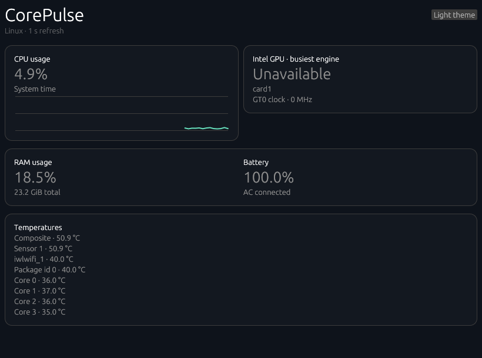

<div align="center">
  <h1>⚡ CorePulse</h1>
  <p><strong>Know your hardware. Keep your resources.</strong></p>
  <p>Read-only CPU, memory, battery and GPU monitoring for Windows and Linux.</p>
  <p>
    <a href="https://github.com/faisalalbdy2004/iris-xe-ai-monitor/actions/workflows/tests.yml?query=branch%3Afeat%2Fmonitor-v0.2.0+event%3Apull_request"></a>
    <a href="https://github.com/faisalalbdy2004/iris-xe-ai-monitor/actions/workflows/rust-experiment.yml?query=branch%3Aexperiment%2Frust-native+event%3Apull_request"></a>
  </p>
  <p>
    <a href="#development-preview">Development preview</a> ·
    <a href="#desktop-screenshot">Screenshot</a> ·
    <a href="#try-the-python-terminal-monitor">Quick start</a> ·
    <a href="#roadmap">Roadmap</a> ·
    <a href="#contributing">Contribute</a>
  </p>
</div>

## Development Preview

> [!IMPORTANT]
> CorePulse is available as working source prototypes. The default branch is the project homepage, and there are no published GitHub Releases. The badges track pull-request checks on the Python and Rust prototype branches.

- **Working prototypes.** Python provides text and JSON snapshots and a live terminal dashboard. Rust provides a native CLI and an experimental desktop dashboard with live charts.
- **Performance work in progress.** Measured trials showed lower idle CPU use after changes to polling and rendering. CPU use during pointer movement remains an open issue. The opt-in Wayland redraw scheduler is being evaluated separately. [Performance measurements and test limits](https://github.com/faisalalbdy2004/iris-xe-ai-monitor/blob/experiment/rust-native/docs/DEVELOPMENT_STATUS.md)
- **Planned.** Test and package Windows and Linux releases, expand Intel coverage beyond the initial Iris Xe focus, and implement and validate AMD and NVIDIA GPU telemetry.

| Track | What you can try | Status |
| --- | --- | --- |
| [Python CLI foundation](https://github.com/faisalalbdy2004/iris-xe-ai-monitor/pull/2) | Text and JSON snapshots of available readings | Open for review |
| [Python v0.2 terminal preview](https://github.com/faisalalbdy2004/iris-xe-ai-monitor/pull/4) | Live terminal dashboard, expanded Intel telemetry and optional Windows temperatures | Open for review, based on the CLI foundation |
| [Rust CLI and desktop](https://github.com/faisalalbdy2004/iris-xe-ai-monitor/pull/6) | Native sampling, terminal snapshots and an optional egui dashboard with charts | Draft, based on the Python v0.2 branch |
| [Wayland redraw experiment](https://github.com/faisalalbdy2004/iris-xe-ai-monitor/blob/review/experimental-wayland-redraw/docs/EXPERIMENTAL_WAYLAND_REDRAW.md) | Opt-in redraw scheduling for native Linux Wayland | Separate experimental branch, with an Intel/KWin smoke test |

## Why CorePulse?

- **Low overhead by design.** The Rust dashboard samples on demand, keeps a bounded chart history, and pauses timer-driven work when its window backend reports minimization.
- **Accurate, transparent readings.** CorePulse compares its measurements with operating-system counters and reports missing readings as `unavailable` or JSON `null`.
- **Read-only monitoring.** CorePulse leaves fan curves, power limits and firmware settings alone.
- **Cross-hardware goals.** Windows and Linux are the target platforms. Intel Iris Xe is the initial GPU focus, with AMD and NVIDIA adapters planned.

## Desktop screenshot



*Live capture of the experimental Rust desktop on Linux, built from [commit `30a5435`](https://github.com/faisalalbdy2004/iris-xe-ai-monitor/commit/30a543507da3b83324b8f1eb00e07796fe72ebcb). The Intel GPU card shows its GT0 clock. Linux GPU utilization is currently unavailable.*

## Hardware and sensor coverage

| Reading | Windows previews | Linux previews |
| --- | --- | --- |
| CPU, memory and power | CPU load, RAM, AC status and battery charge where available | CPU load, RAM, AC status and battery charge where available |
| Intel graphics | Iris Xe is the initial testing focus. Utilization uses the busiest reported engine through WDDM when usable counters are available. | Actual Intel GPU frequency where i915 or Xe exposes it. GPU utilization is currently unavailable. |
| Temperatures | Python v0.2 supports optional Libre Hardware Monitor readings. Rust temperatures are unavailable. | Sensors exposed through the OS, with coverage dependent on hardware and drivers. |
| AMD and NVIDIA graphics | GPU adapters and validation are planned. | GPU adapters and validation are planned. |

## Try the Python terminal monitor

Install Git and Python 3.10 or later. Clone the v0.2 preview branch and enter the checkout.

```sh
git clone --branch feat/monitor-v0.2.0 https://github.com/faisalalbdy2004/iris-xe-ai-monitor.git corepulse-terminal
cd corepulse-terminal
```

**Linux**

```sh
python3 -m venv .venv
.venv/bin/python -m pip install .
.venv/bin/iris-monitor status --json
.venv/bin/iris-monitor watch --interval 1 --count 3
```

**Windows (PowerShell)**

```powershell
python -m venv .venv
.\.venv\Scripts\python.exe -m pip install .
.\.venv\Scripts\iris-monitor.exe status --json
.\.venv\Scripts\iris-monitor.exe watch --interval 1 --count 3
```

Run `status` without `--json` for a text snapshot. Omit `--count 3` for continuous monitoring and press Ctrl+C to stop. For optional Windows temperatures, see the `--lhm` setup in the [Python preview README](https://github.com/faisalalbdy2004/iris-xe-ai-monitor/tree/feat/monitor-v0.2.0#optional-windows-temperatures).

## Build the experimental Rust desktop

Install Git and a current stable Rust toolchain with Cargo and your platform's linker. The desktop requires a working OpenGL context. On Linux it supports X11 or Wayland and needs libxkbcommon, plus libxkbcommon-x11 when using X11.

```sh
git clone --branch experiment/rust-native https://github.com/faisalalbdy2004/iris-xe-ai-monitor.git corepulse-rust
cd corepulse-rust
cargo run --manifest-path rust-monitor/Cargo.toml --locked --release --features gui -- gui
```

Run a headless snapshot from the same checkout.

```sh
cargo run --manifest-path rust-monitor/Cargo.toml --locked --release -- status --json
```

The desktop shows live charts with gaps where readings are missing. See the [Rust build and validation guide](https://github.com/faisalalbdy2004/iris-xe-ai-monitor/tree/experiment/rust-native/rust-monitor) for tests, watch mode and benchmarks, and the [Arch/Hyprland acceptance guide](https://github.com/faisalalbdy2004/iris-xe-ai-monitor/blob/experiment/rust-native/docs/ARCH_HYPRLAND.md) for compositor testing.

## Roadmap

- [x] Prototype Python snapshots and a live terminal dashboard.
- [x] Prototype a native Rust CLI and a desktop dashboard with live charts.
- [x] Record initial sensor comparisons and desktop overhead measurements.
- [ ] Validate sensor accuracy and overhead across more Intel systems, drivers and Linux compositors.
- [ ] Reduce desktop rendering overhead during input and validate the opt-in Wayland scheduler.
- [ ] Build and test Windows and Linux release packages.
- [ ] Expand Intel coverage and implement and validate AMD and NVIDIA GPU adapters.

## Contributing

Hardware reports are welcome. Include the branch or commit, OS, GPU model and driver, the command you ran and the reading you expected. If you share a benchmark, include the sampling interval, workload and reference tool.

[Open an issue](https://github.com/faisalalbdy2004/iris-xe-ai-monitor/issues/new) · [Read the contribution guide](CONTRIBUTING.md)

## License

CorePulse is available under the [MIT License](LICENSE).
